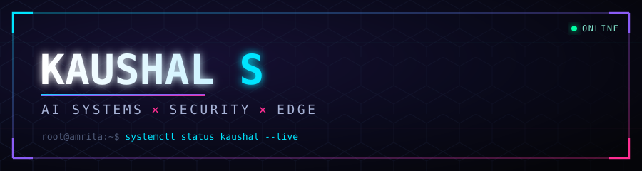
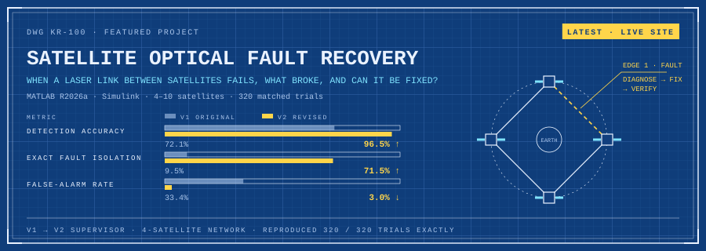
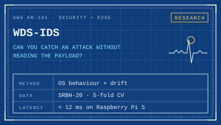
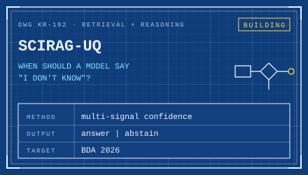
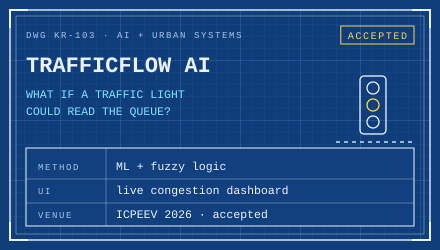
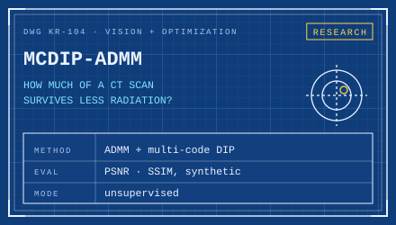
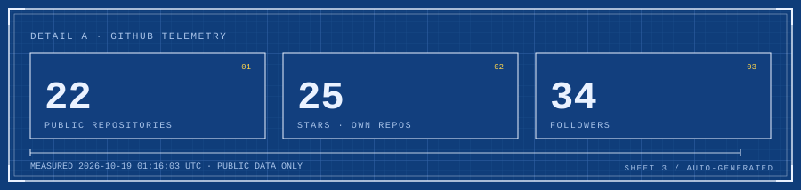
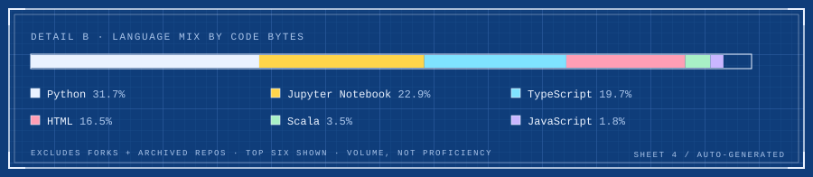
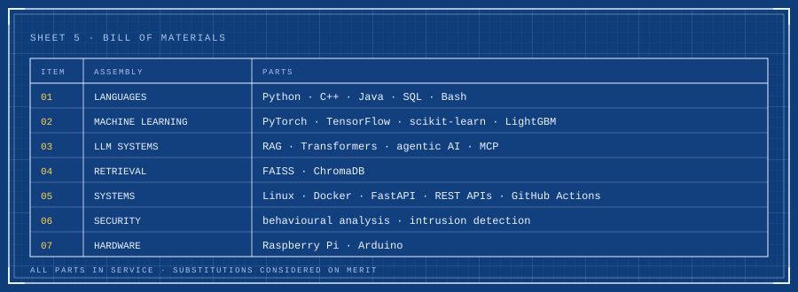

<picture>
  <source media="(prefers-color-scheme: light)" srcset="assets/banner-light.svg">
  
</picture>

  <code>PORTFOLIO</code> <a href="https://kaushalrog.github.io/portfolio/">kaushalrog.github.io/portfolio</a> &nbsp;·&nbsp;
  <code>LINKEDIN</code> <a href="https://www.linkedin.com/in/kaushal-s-19234b314/">kaushal-s</a> &nbsp;·&nbsp;
  <code>PAPER</code> <a href="https://ieeexplore.ieee.org/abstract/document/11426098">IEEE Xplore</a>

> [!NOTE]
> **The demo always works. I build for the run after the demo.**
> I'm Kaushal. I work where AI, security and edge hardware meet: models that admit when they're unsure, intrusion detection that watches how a system behaves instead of what it's sent, and code small enough to run on a Raspberry Pi.

## `SHEET 2` &nbsp;Open questions

<a href="https://kaushalrog.github.io/Satellite-Optical-Fault-Recovery/"><picture><source media="(prefers-color-scheme: light)" srcset="assets/featured-light.svg"></picture></a>

<b>Latest:</b> <a href="https://kaushalrog.github.io/Satellite-Optical-Fault-Recovery/">▶ Live simulator</a> &nbsp;·&nbsp; <a href="https://kaushalrog.github.io/Satellite-Optical-Fault-Recovery/results.html">MATLAB results</a> &nbsp;·&nbsp; <a href="https://github.com/kaushalrog/Satellite-Optical-Fault-Recovery">Repository</a> Also live: <a href="https://kaushalrog.github.io/Spacecraft-Formation-Attitude-Control/">Spacecraft formation attitude-control digital twin</a>

<table>
<tr>
<td width="50%"><a href="https://github.com/kaushalrog/ids---System"><picture><source media="(prefers-color-scheme: light)" srcset="assets/card-wds-ids-light.svg"></picture></a></td>
<td width="50%"><a href="https://github.com/kaushalrog/scirag-uq"><picture><source media="(prefers-color-scheme: light)" srcset="assets/card-scirag-uq-light.svg"></picture></a></td>
</tr>
<tr>
<td width="50%"><a href="https://github.com/kaushalrog/TrafficFlowAI"><picture><source media="(prefers-color-scheme: light)" srcset="assets/card-trafficflow-light.svg"></picture></a></td>
<td width="50%"><a href="https://github.com/kaushalrog/mcdip-admm-ct-reconstruction"><picture><source media="(prefers-color-scheme: light)" srcset="assets/card-ct-recon-light.svg"></picture></a></td>
</tr>
</table>

Select a sheet to open its repository. Off the drawing board: <a href="https://ieeexplore.ieee.org/abstract/document/11426098"><b>AntBot</b></a>, a hexapod surveillance robot, published on IEEE Xplore.

## `SHEET 3–4` &nbsp;Live telemetry

<picture>
  <source media="(prefers-color-scheme: light)" srcset="assets/stats-light.svg">
  
</picture>

<picture>
  <source media="(prefers-color-scheme: light)" srcset="assets/languages-light.svg">
  
</picture>

<b>Change log</b> · latest public activity

<!--START:ACTIVITY-->
| Date (UTC) | Activity | Repository |
| :--- | :--- | :--- |
| 2026-10-16 | Push · Pushed code | [kaushalrog/Satellite-Optical-Fault-Recovery](https://github.com/kaushalrog/Satellite-Optical-Fault-Recovery) |
| 2026-10-16 | Push · Pushed code | [kaushalrog/Satellite-Optical-Fault-Recovery](https://github.com/kaushalrog/Satellite-Optical-Fault-Recovery) |
| 2026-10-16 | Push · Pushed code | [kaushalrog/Satellite-Optical-Fault-Recovery](https://github.com/kaushalrog/Satellite-Optical-Fault-Recovery) |
| 2026-10-16 | Push · Pushed code | [kaushalrog/LegalRAG-AI](https://github.com/kaushalrog/LegalRAG-AI) |
| 2026-10-15 | Push · Pushed code | [kaushalrog/Satellite-Optical-Fault-Recovery](https://github.com/kaushalrog/Satellite-Optical-Fault-Recovery) |
<!--END:ACTIVITY-->

<b>Project pulse</b> · last 30 days

<!--START:PROJECT_PULSE-->
| Project | Your commits · last 30 days | Latest push (UTC) |
| :--- | ---: | :--- |
| [WDS-IDS](https://github.com/kaushalrog/ids---System) | 0 | 2026-08-27 |
| [SciRAG-UQ](https://github.com/kaushalrog/scirag-uq) | 0 | 2026-07-02 |
| [TrafficFlow](https://github.com/kaushalrog/TrafficFlowAI) | 1 | 2026-09-23 |
| [CT Reconstruction](https://github.com/kaushalrog/mcdip-admm-ct-reconstruction) | 1 | 2026-10-14 |
<!--END:PROJECT_PULSE-->

My commits on each project's default branch. A quiet repository can be finished work; activity is not a quality score.

## `SHEET 5` &nbsp;Bill of materials

<picture>
  <source media="(prefers-color-scheme: light)" srcset="assets/bom-light.svg">
  
</picture>

## General notes

1. Off the clock I shoot campus events with Team Media at Amrita.
2. Badminton, between builds.
3. I read papers until one of them turns into an experiment.
4. **Building something thoughtful in AI or security?** [Send a note on LinkedIn →](https://www.linkedin.com/in/kaushal-s-19234b314/)

Drawing sheets 3–4 and the change log are regenerated by <a href="https://github.com/kaushalrog/kaushalrog/actions/workflows/telemetry.yml">GitHub Actions</a> hourly, on profile-repo pushes, or on demand · latest snapshot: 2026-10-16T22:50:57Z · public data only.
